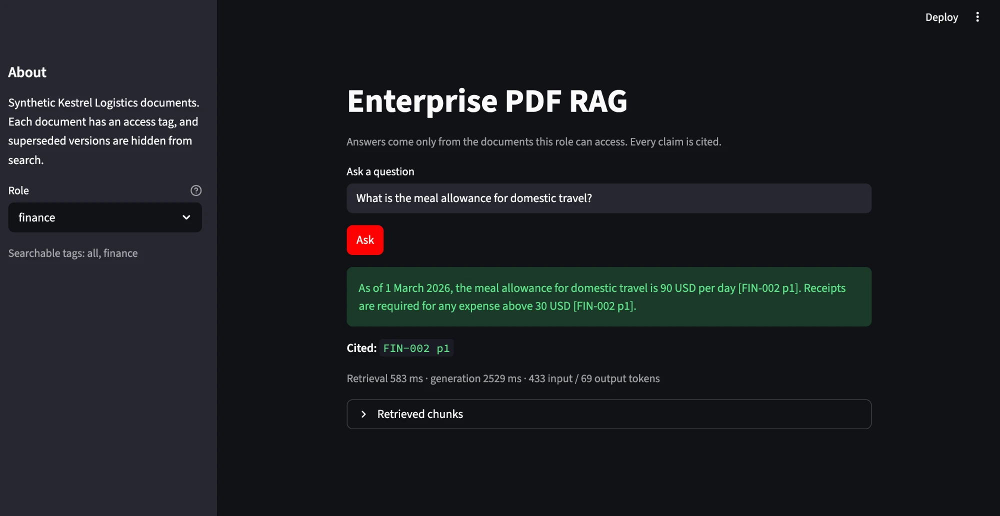
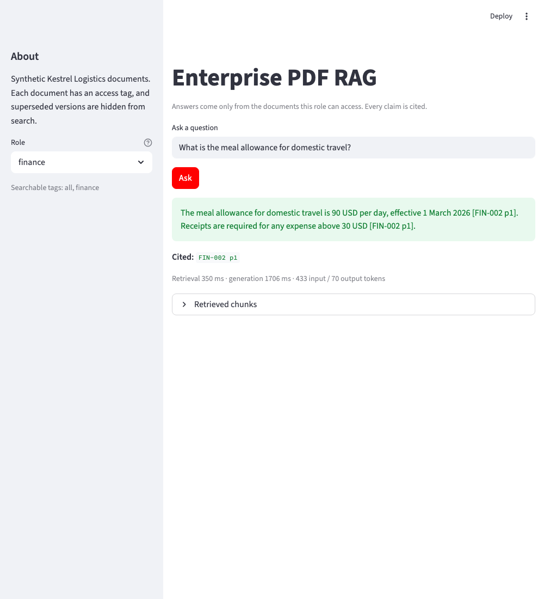

# Enterprise PDF RAG

🔗 **Live app:** [03-enterprise-pdf-rag.streamlit.app](https://03-enterprise-pdf-rag-e2gmxxgtomfotzpj9samzn.streamlit.app/)

A grounded question-answering assistant over internal company PDFs. It answers only from the documents a user's role is allowed to see, cites the page for each claim, and refuses when the documents don't support an answer.

The point of the project is not the chatbot. It is measuring where a bad answer comes from: the search step missing the right page, or the language model misreading a page it was given.

> The corpus is **synthetic** (a fictional company, Kestrel Logistics). No real company data is included.





## Problem

Employees ask policy questions, and the answers sit in dozens of PDFs with different owners, access levels, and versions. A plain chatbot will answer confidently from the wrong document, or from a superseded policy. The product question is: **when should the assistant answer, when should it refuse, and how do we know it's right?**

The full requirements are in [docs/PRD.md](docs/PRD.md).

## What it does

- Ingests 12 PDFs (19 pages) with metadata: document ID, owner, date, status, and access tag.
- Searches only the documents the selected role can access (`all` plus the role's own tag).
- Hides superseded versions. For example, the v2 expense policy is never used once v3 is current.
- Answers from the retrieved passages with Claude, citing each claim as `[DOC-ID pN]`.
- Refuses with a fixed sentence when the passages don't contain the answer.

## Architecture

```text
PDFs ──► parse (pypdf) ──► clean ──► chunk by section ──► metadata
                                                             │
                                                             ▼
                                          embed (bge-small, local) ──► Chroma index
                                                                             │
question + role ──► embed ──► filter (role access, status=current) ──► top 4 passages
                                                                             │
                                                                             ▼
                                             Claude (answer only from passages, cite or refuse)
                                                                             │
                                                                             ▼
                                                         answer + citations + retrieved chunks
```

| Piece | Choice | Why |
|---|---|---|
| PDF parsing | `pypdf` | Enough for clean text PDFs; no OCR needed |
| Chunking | Split on section headings, max 600 characters, 80 overlap | Keeps each policy clause intact, with its heading |
| Embeddings | `BAAI/bge-small-en-v1.5`, local | Free, no per-call cost, good enough for a small corpus |
| Vector store | Chroma, persisted to disk | Stores metadata alongside vectors, so access and status filters run inside the search |
| Hybrid / reranker | Not used yet | Added only if evals show exact-term misses; not needed on the first pass |
| Answer model | Claude (`claude-sonnet-5-5`), 600-token limit | Writes the grounded answer and citations |

## Access and freshness rules

| Role | Searchable tags |
|---|---|
| all | all |
| hr | all, hr |
| finance | all, finance |
| security | all, security |

Only documents with `status: current` are searched. Superseded documents stay in the corpus for history but are never retrieved.

## Eval set

35 questions, each with the gold document and page, the words a correct answer must contain, and any words that must not appear. Words are matched as whole words, so "3" does not match "13:00".

| Category | Count | What it tests |
|---|---|---|
| Factual, single document | 18 | Finding one fact on one page |
| Multi-document | 2 | Combining two pages from different documents |
| Conflicting or stale | 2 | Using the current policy, not the superseded one |
| Access-denied | 1 | A role without access must not see HR-only content |
| No answer | 2 | Refusing when the documents don't cover the question |
| Hard (added later) | 10 | Vague wording, typos, paraphrase, two documents at once, access, prompt injection, near-miss refusals |

## Results

### Full run with Claude answers (measured)

Run with `python eval_run.py` on all 35 questions.

| Metric | Result | Detail |
|---|---|---|
| Recall@4 | 100% | Gold page in the top 4 for all 28 answerable questions |
| Answer accuracy | 97% | 34 of 35 |
| Refusal accuracy | 100% | All 7 must-refuse items, including the access and prompt-injection traps |
| Citation correctness | 96% | 27 of 28 answerable questions |
| Median retrieval latency | 70 ms | |
| Median generation latency | 1,521 ms | |
| Tokens (35 questions) | 15,296 input, 2,283 output | |

### The one failure (Q35)

**Q35: "How fast must we respond to a major outage?"** The right page (`SEC-002 p1`) was retrieved, but Claude refused. The document says "Severity 1 incident", and the question says "major outage". The model didn't connect the two terms, so it was too cautious.

This is a real finding, not a grader problem. It points to vocabulary mismatch between how people ask and how policies are written. The fixes are to add synonyms to the chunk text, or to try hybrid keyword search. Neither is in this version, and I haven't changed the prompt to make this one question pass.

### Fixed during this run

- **Q34 returned an empty answer.** The 300-token limit ran out before Claude wrote any text. The grader had labelled it as a citation error. The limit is now 600 tokens, and empty answers have their own label (`empty-answer`).
- **Q15 was marked wrong for a correct citation.** The grader now accepts any retrieved page that supports a claim, as long as at least one citation is a gold page.
- **Substring matching gave false passes.** Required and forbidden terms are now matched as whole words.

### Retrieval only (no API key needed)

Run with `python eval_run.py --retrieval-only`. This checks the search step on its own. Recall@4 is 100% on all 28 answerable questions, the `all` role gets no HR-only passages for the bonus question, and the superseded v2 expense policy never appears in results.

### Caveat on the scores

Answer accuracy is still graded by words, so it confirms the key facts and refusals but can't judge wording or catch a paraphrase that drifts from the source. Read the answers yourself before relying on these numbers.

## Run locally

```bash
pip install -r requirements.txt
python make_corpus.py                 # generate the synthetic PDFs
python ingest.py                      # build the Chroma index
python eval_run.py --retrieval-only   # retrieval check, no API key needed
export ANTHROPIC_API_KEY="your-key"
python eval_run.py                    # full eval with Claude answers
streamlit run app.py                  # demo UI
```

## Project structure

```text
03-enterprise-pdf-rag/
├── app.py              # Streamlit demo
├── rag.py              # retrieval with access filter, grounded answer with Claude
├── ingest.py           # parse, clean, chunk, embed, index
├── make_corpus.py      # generates the synthetic PDFs
├── eval_run.py              # runs the eval and writes the report
├── generate_candidates.py   # drafts candidate eval questions from the chunks (pending review)
├── promote_candidates.py    # moves approved candidates into the eval set
├── corpus/
│   ├── manifest.json        # per-document metadata: owner, date, status, access
│   └── pdfs/                # generated PDFs
├── docs/
│   ├── PRD.md               # product requirements, targets, risks
│   ├── app_answer.png       # screenshot (local app)
│   └── live_app_answer.png  # screenshot (live app)
├── eval/
│   ├── questions.json       # 35 questions with gold answers
│   ├── candidates.json      # drafted questions awaiting review, with a status for each
│   ├── review_candidates.md # readable table of the drafts for review
│   ├── report.md            # eval report
│   └── results.json         # raw results
└── requirements.txt
```

## Generating new eval questions

Writing eval questions by hand doesn't scale, so the project can draft them from the chunks. A person still approves every question before it counts.

1. `python generate_candidates.py` asks Claude to write two questions per current chunk, plus refusal questions. The gold page is taken from the chunk automatically. Each draft is saved in `eval/candidates.json` with status `pending`.
2. Read `eval/review_candidates.md`, the readable table of the drafts. Check that each question is realistic, that the gold page really holds the answer, and that the key facts are right.
3. In `eval/candidates.json`, set each keeper's `status` to `approved` and each reject to `rejected`. Edit any wording that's wrong.
4. `python promote_candidates.py` copies the approved items into `eval/questions.json` with new IDs. Each one is marked `promoted`, so running it again doesn't add duplicates.

Generated questions tend to reuse the document's own wording, so they're easier than real user questions. Hard, indirect questions still need to be written by people.

## Limitations

- **Synthetic corpus.** Real policy documents are longer, messier, and include tables and scanned pages. Scanned PDFs would need OCR.
- **Vocabulary mismatch.** As Q35 shows, the system misses a question that uses different words from the policy.
- **Keyword-scored eval.** This is coarse and can't judge whether a paraphrase is correct, so a human review of answers is still needed.
- **Role-based access is simulated.** A production system would take roles from the identity provider and enforce access in the document store, not in app code.
- **No conversation memory.** Each question is answered on its own.
- **Long-section chunking is untested.** Every section in this corpus is short, about 23 words and 32 tokens per chunk. The 600-character split and overlap logic never runs here. Real policy sections are longer, so that path needs a longer test document before it can be trusted.
- **Generated questions are easier than real ones.** They mirror the source wording, so the drafted candidates need human review and can't replace hand-written hard cases.

## What I would do in production

- Pull roles from SSO and enforce access where the documents are stored.
- Fix vocabulary mismatch with synonyms in the chunk text or hybrid keyword search, once the eval confirms it's the cause.
- Re-index on document change, with a version history, instead of rebuilding the whole index.
- Track a weekly eval on real questions from users, and feed failures back into the eval set.
- Set a cost ceiling per question and a latency budget, and monitor both.
